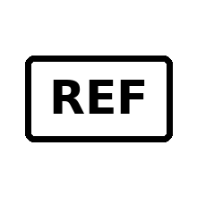
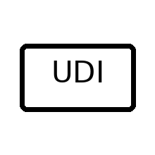

**[Footer]** AGNAVELIS Silver Nitrate Applicator Sticks | IFU-AGN-00 | Rev. 00 |

**Silver Nitrate Applicator Sticks**

75% Silver Nitrate / 25% Potassium Nitrate

**INSTRUCTIONS FOR USE / KULLANIM KILAVUZU**

| Manufacturer / Üretici | Genco Tıbbi Cihazlar San. Tic. Ltd. Şti. |
| --- | --- |
| Address / Adres | Meriç Mah. 5746/5 Sk. No: 3 İç Kapı No: Z1 Bornova / İzmir / TÜRKİYE |
| Contact / İletişim | +90 232 462 16 49 \| info@gencotibbi.com \| www.gencotibbi.com |
| Product Status / Ürün Statüsü | Medical Device – Class I – Non-Sterile – Single Use / Tıbbi Cihaz – Sınıf I – Non-Steril – Tek Kullanımlık |
| IFU No. | IFU-AGN-00 |
| Revision / Revizyon | Rev. 00 |
| Issue Date / Yayın Tarihi | 03.09.2026 |

| TÜRKÇE KULLANIM KILAVUZU |
| --- |

1. Ürün Tanımı**

**AGNAVELIS Gümüş Nitrat Uygulama Çubuğu, **uç kısmında %75 gümüş nitrat ve %25 potasyum nitrat karışımı bulunan, lokal kimyasal koterizasyon amacıyla kullanılan, non-steril ve tek kullanımlık bir üründür. Ürün profesyonel sağlık çalışanlarının kontrollü uygulaması için tasarlanmıştır.

2. Kullanım Amacı**

Küçük ve sınırlı yüzeylerde kontrollü, lokal kimyasal koterizasyon sağlamak amacıyla kullanılır. Klinik kullanım kapsamı, üreticinin teknik dosyasında tanımlanan endikasyonlarla sınırlıdır.

- Yüzeysel ve küçük kanama alanlarının kimyasal koterizasyonu.

- Aşırı granülasyon / hipergranülasyon dokusunun kontrollü olarak azaltılması.

- Yara ve stoma bakımında klinik olarak uygun görülen sınırlı alan uygulamaları.

- Sağlık profesyoneli tarafından uygun görülen diğer küçük, yüzeysel lezyonlarda lokal koterizasyon.

3. Hedef Kullanıcı ve Hasta Grubu**

**Hedef kullanıcı: **Eğitimli sağlık profesyonelleri.

**Hasta grubu: **Klinik değerlendirme sonucunda lokal kimyasal koterizasyonun uygun görüldüğü hastalar. Pediatrik kullanım, gebelik ve emzirme dönemindeki kullanım yalnızca bireysel klinik değerlendirme sonrasında yapılmalıdır.

4. Kontrendikasyonlar**

- Gümüş nitrat veya potasyum nitrata karşı bilinen aşırı duyarlılık.

- Tanısı belirsiz, malignite şüphesi bulunan, alışılmadık renk veya şekle sahip lezyonlar; uzman hekim değerlendirmesi olmadan kullanılmamalıdır.

- Göz ve göz çevresinde doğrudan kullanım.

- Geniş vücut yüzeylerinde, derin dokularda veya ürünün kullanım amacı dışında uygulama.

5. Uyarılar ve Önlemler**

- Yalnızca profesyonel kullanım içindir.

- Ürün NON-STERİLDİR. Steril bir işlem alanı gerektiren uygulamalarda kullanılmamalıdır.

- Tek kullanımlıktır. Kullanılmış çubuğu tekrar kullanmayın, yeniden işlemeyin veya yeniden sterilize etmeyin.

- Aktif uca çıplak veya ıslak elle dokunmayın. Uygun eldiven ve gerektiğinde göz koruması kullanın.

- Sağlıklı dokuyla teması mümkün olduğunca sınırlandırın. Gümüş nitrat sağlam dokuda kimyasal irritasyona ve koyu renklenmeye neden olabilir.

- Giysi, çalışma yüzeyi ve ekipmanları koruyun; gümüş nitrat kalıcı kahverengi-siyah lekeler oluşturabilir.

- Ağız çevresinde kullanımda aktif uç parçalarının yutulmasını önleyin.

- Çocukların ulaşamayacağı yerde saklayın.

- Ambalajı hasarlı, ıslanmış veya üründe görünür bozulma olan çubukları kullanmayın.

6. Kullanım Talimatı**

1. Ürün etiketindeki REF, LOT ve son kullanma tarihini kontrol edin. Son kullanma tarihi geçmiş ürünü kullanmayın.

1. Uygulama alanını klinik protokole göre temizleyin ve gerekiyorsa kurulayın.

1. Bir adet çubuğu ambalajdan çıkarın. Aktif uca dokunmayın.

1. Aktif ucu kısa süreyle distile, deiyonize veya saflaştırılmış su ile nemlendirin. Normal serum fizyolojik (sodyum klorür) ile aktive etmeyin; klorür iyonları gümüş nitratın etkisini azaltabilir.

1. Nemlendirilmiş ucu yalnızca hedef dokuya kontrollü biçimde hafifçe dokundurun, yuvarlayın veya kısa süreli sürün. Gereksiz basınç uygulamayın ve sağlam dokuyla temastan kaçının.

1. Uygulama sonrası klinik yanıtı değerlendirin. Gereğinden fazla veya tekrarlayan uygulama lokal irritasyon ve inflamasyona yol açabilir.

1. Uygulama sırasında istenmeyen sağlam doku teması oluşursa bölgeyi bol suyla temizleyin. Kimyasal etkinin durdurulması gerektiğinde uygun klinik protokol kapsamında %0,9 sodyum klorür kullanılabilir.

1. Kullanılmış çubuğu derhal uygun klinik/kimyasal atık prosedürüne göre imha edin. Tekrar kullanmayın.

7. Beklenen Etkiler ve Olası İstenmeyen Etkiler**

- Uygulanan alanda gri, kahverengi veya siyaha dönen renk değişikliği / eskar oluşumu görülebilir.

- Geçici yanma, batma, kızarıklık veya lokal irritasyon oluşabilir.

- Aşırı veya tekrarlayan uygulamada sağlam dokuda kimyasal hasar ve inflamasyon gelişebilir.

- Beklenmeyen reaksiyon, şiddetli ağrı, aşırı doku hasarı veya aşırı duyarlılık bulgularında uygulamayı durdurun ve klinik değerlendirme yapın.

8. Kaza Sonucu Temas**

- Göz teması: Gözü açık tutarak derhal bol suyla en az 5 dakika yıkayın ve tıbbi değerlendirme sağlayın.

- Sağlıklı deri teması: Bol akan suyla temizleyin. Geçici koyu renklenme oluşabilir.

- Yutma veya ağız içine parça kaçması: Derhal tıbbi değerlendirme sağlayın.

9. Saklama ve Raf Ömrü**

- Işıktan koruyarak, kuru ortamda ve orijinal ambalajında saklayın.

- Ambalaj açıldıktan sonra kullanılmayan ürünleri tekrar sıkıca kapatın ve nemden koruyun.

- Saklama sıcaklığı: Oda Sıcaklığında saklayın

- Son kullanma tarihi ambalaj üzerinde belirtilmiştir. Son kullanma tarihinden sonra kullanmayın.

10. Bertaraf**

Kullanılmış veya kullanım dışı ürünleri yerel mevzuata ve kurum prosedürlerine uygun şekilde klinik/kimyasal atık olarak bertaraf edin. Kanalizasyona veya kontrolsüz evsel atığa atmayın.

11. Ciddi Olay Bildirimi**

Ürünle ilişkili meydana gelen herhangi bir ciddi olay, Genco Tıbbi Cihazlar San. Tic. Ltd. Şti.'ye ve kullanıcının/hastanın bulunduğu ülkedeki yetkili otoriteye bildirilmelidir.

12. Semboller / Etiket Bilgileri**

.

| Sembol | AÇIKLAMA |
| --- | --- |
| [IMG5] | Manufacturer / Üretici |
|   | Date of manufacture / Üretim tarihi |
|   | Use-by date / Son kullanma tarihi |
| [IMG7] | Batch code / Lot kodu |
| [IMG8] | Catalogue number / Katalog no. (REF) |
|   | Non-sterile / Non-steril |
|   | Do not use if package is damaged / Ambalaj hasarlıysa kullanmayın |
|   | Keep away from sunlight / Güneş ışığından koruyun |
|   | Keep dry / Kuru tutun |
|   | Do not re-use / Tekrar kullanmayın |
|   | Consult instructions for use / Kullanım kılavuzuna başvurun |
| [IMG9] | Medical device / Tıbbi cihaz |
| [IMG10] | Unique device identifier (UDI) / Benzersiz cihaz kimliği |

| ENGLISH INSTRUCTIONS FOR USE |
| --- |

1. Product Description**

**AGNAVELIS Silver Nitrate Applicator Stick **is a non-sterile, single-use applicator with a tip containing 75% silver nitrate and 25% potassium nitrate. It is intended for controlled, localized chemical cauterization by trained healthcare professionals.

2. Intended Purpose**

The product is intended to provide controlled, localized chemical cauterization of small and clearly defined superficial tissue areas. Clinical use must remain within the indications supported by the manufacturer's technical documentation.

- Chemical cauterization of small superficial bleeding sites.

- Controlled reduction of excessive granulation / hypergranulation tissue.

- Clinically appropriate localized applications in wound and stoma care.

- Other small superficial lesions where localized cauterization is considered appropriate by a healthcare professional.

3. Intended User and Patient Population**

**Intended user: **Trained healthcare professionals.

**Patient population: **Patients for whom localized chemical cauterization is clinically indicated. Use in pediatric patients, during pregnancy or breastfeeding should follow an individual professional clinical assessment.

4. Contraindications**

- Known hypersensitivity to silver nitrate or potassium nitrate.

- Uncertain, atypically coloured or shaped lesions or lesions suspected of malignancy unless assessed by an appropriate physician.

- Direct application to the eye or peri-ocular tissues.

- Use over large body surface areas, deep tissues, or outside the intended purpose.

5. Warnings and Precautions**

- For professional use only.

- The product is NON-STERILE. Do not use where a sterile device is required by the procedure.

- Single use only. Do not reuse, reprocess or re-sterilize.

- Do not touch the active tip with bare or wet hands. Wear appropriate gloves and eye protection where indicated.

- Limit contact with healthy tissue. Silver nitrate may cause chemical irritation and dark staining of healthy skin.

- Protect clothing, work surfaces and equipment; silver nitrate may cause persistent brown-black stains.

- When used in or near the mouth, prevent ingestion of fragments of the active tip.

- Keep out of reach of children.

- Do not use if the packaging is damaged, wet or if the product shows visible deterioration.

6. Instructions for Use**

1. Check the REF, LOT and expiry date on the product label. Do not use after the expiry date.

1. Prepare and clean the treatment site according to the applicable clinical protocol; dry the area when appropriate.

1. Remove one applicator from the package. Do not touch the active tip.

1. Briefly moisten the active tip with distilled, deionized or purified water. Do not activate the tip with normal saline (sodium chloride), as chloride ions may reduce the action of silver nitrate.

1. Apply the moistened tip precisely to the target tissue by gentle dabbing, rolling or brief rubbing. Avoid unnecessary pressure and contact with healthy tissue.

1. Assess the clinical response. Excessive or repeated application may cause local irritation or inflammation.

1. If unintended contact with healthy tissue occurs, rinse the area thoroughly with water. Where clinically appropriate, 0.9% sodium chloride may be used to stop the local action of silver nitrate.

1. Discard the used applicator immediately in accordance with local clinical/chemical waste procedures. Do not reuse.

7. Expected Effects and Possible Undesirable Effects**

- Grey, brown or black discoloration and local eschar formation may occur at the treated site.

- Temporary stinging, burning, redness or local irritation may occur.

- Excessive or repeated application may cause chemical injury or inflammation of surrounding healthy tissue.

- Stop application and obtain clinical assessment in case of unexpected reaction, severe pain, excessive tissue injury or signs of hypersensitivity.

8. Accidental Exposure**

- Eye contact: Immediately rinse the open eye with plenty of running water for at least 5 minutes and obtain medical assessment.

- Healthy skin contact: Rinse thoroughly with running water. Temporary dark discoloration may occur.

- Ingestion or detachment of tip material into the mouth: Obtain prompt medical assessment.

9. Storage and Shelf Life**

- Store dry, protected from light and in the original packaging.

- After opening, reseal the remaining product securely and protect from moisture.

- Storage temperature: [INSERT VALIDATED TEMPERATURE RANGE FROM TECHNICAL DOCUMENTATION].

- The expiry date is stated on the label. Do not use after the expiry date.

10. Disposal**

Dispose of used and unused product in accordance with local requirements and healthcare-facility procedures for clinical/chemical waste. Do not discharge into drains or dispose of uncontrolled household waste.

11. Serious Incident Reporting**

Any serious incident that has occurred in relation to the device should be reported to Genco Tıbbi Cihazlar San. Tic. Ltd. Şti. and to the competent authority of the country in which the user and/or patient is established.

12. Label Information / Symbols**

The symbols below are provided in accordance with ISO 15223-1:2021 “Medical devices — Symbols to be used with information to be supplied by the manufacturer — Part 1: General requirements”, taking ISO 15223-1:2021/Amd 1:2025 into account. “Class I” is a device classification and is not an ISO 15223-1 symbol; where needed, it is stated as text.

| Sembol | AÇIKLAMA |
| --- | --- |
| [IMG5] | Manufacturer / Üretici |
|   | Date of manufacture / Üretim tarihi |
| [IMG6] | Use-by date / Son kullanma tarihi |
| [IMG7] | Batch code / Lot kodu |
| [IMG8] | Catalogue number / Katalog no. (REF) |
|   | Non-sterile / Non-steril |
|   | Do not use if package is damaged / Ambalaj hasarlıysa kullanmayın |
|   | Keep away from sunlight / Güneş ışığından koruyun |
|   | Keep dry / Kuru tutun |
|   | Do not re-use / Tekrar kullanmayın |
|   | Consult instructions for use / Kullanım kılavuzuna başvurun |
| [IMG9] | Medical device / Tıbbi cihaz |
| [IMG10] | Unique device identifier (UDI) / Benzersiz cihaz kimliği |

**Manufacturer / Üretici**

| Genco Tıbbi Cihazlar San. Tic. Ltd. Şti. |
| --- |
| Meriç Mah. 5746/5 Sk. No: 3 İç Kapı No: Z1 Bornova / İzmir / TÜRKİYE |
| +90 232 462 16 49 \| info@gencotibbi.com |
| www.gencotibbi.com |

[Floating images with uncertain positions]

